# Machine Learning for Recognizing Epileptic Seizures in EEG Recordings

*A comparative study of five classifiers on the Bonn EEG dataset, with a step-by-step guide to building the same kind of model on your own data.*

> **Disclaimer:** This is an exploratory study on a public research dataset. The models have not been clinically validated and must not be used for diagnosis or medical decision-making.

📄 **Full paper:** [paper.pdf](paper.pdf) &nbsp;·&nbsp; [](https://colab.research.google.com/github/sanjambahl/eeg-seizure-detection/blob/main/notebooks/EEG_Seizure_Detection_Colab.ipynb)

---

## Overview

Epilepsy affects around 50 million people worldwide, and electroencephalography (EEG) is central to its diagnosis. Reviewing EEG for seizure activity is largely manual. This project builds a complete machine-learning pipeline that turns raw EEG into features, trains five classifiers to recognize seizure activity and epilepsy-related patterns, and examines which signal characteristics and evaluation choices drive the results.

**Pipeline:** 500 single-channel recordings → band-pass filter (0.5–40 Hz) → 5,500 two-second windows → 18 features per window → 5 classifiers → recording-grouped cross-validation, so every test recording is unseen during training.

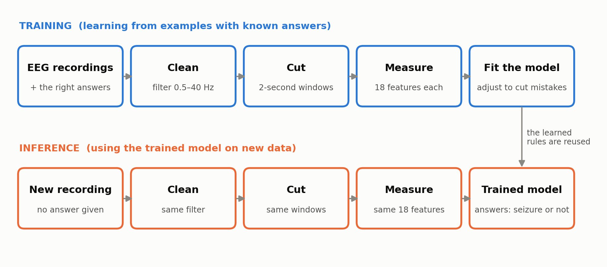

## Key results

| Task | Best classifier | Balanced accuracy per window | Per recording | AUC |
|---|---|---:|---:|---:|
| T1 Seizure vs healthy (A vs E) | Random forest | 100.0% | 100.0% | 1.000 |
| T2 Seizure vs all non-seizure (A–D vs E) | Logistic regression | 97.5% | 98.3% | 0.995 |
| T3 Seizure vs interictal (C+D vs E) | Gradient boosting | 97.3% | 97.8% | 0.997 |
| T4 Healthy vs interictal (A+B vs C+D) | Gradient boosting | 96.7% | 99.2% | 0.995 |
| T5 Epileptogenic zone vs contralateral (C vs D) | SVM | 71.8% | 81.3% | 0.794 |
| T6 Five-class (chance = 20%) | Gradient boosting | 79.3% | 87.4% | — |

**Main findings**

1. **Seizure EEG is recognized with high accuracy.** All five classifiers reached 96.6–97.5% balanced accuracy on T2 (97.0–98.3% per recording), and 96.4–97.3% on T3, where every recording is intracranial.
2. **Amplitude drives much of that accuracy.** On T1, signal amplitude alone (one feature) scored 99.7%, as well as the full models. A high score does not by itself mean a model has learned rich structure.
3. **Subtler patterns are harder and data-limited.** Separating the epileptogenic zone from the opposite hemisphere between seizures (T5) reached up to 71.8% per window and 81.3% per recording, and was still improving as training data increased.
4. **Evaluation choices matter.** Splitting by window instead of by recording inflated accuracy by up to 3.1 points. A detector trained only on eyes-open healthy EEG as "normal" flagged 32.2% of interictal seizure-zone windows as seizures; training on all non-seizure classes reduced this to 3.8%.
5. **Recording setup is a confound.** Healthy recordings (A, B) are scalp EEG and patient recordings (C, D, E) are intracranial, so T4 results cannot be attributed to epilepsy alone.

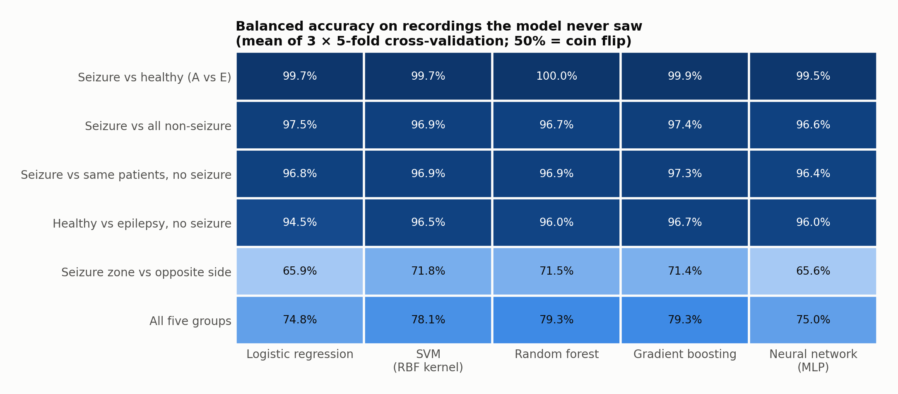

<details>
<summary><b>More figures</b></summary>

| | |
|---|---|
| 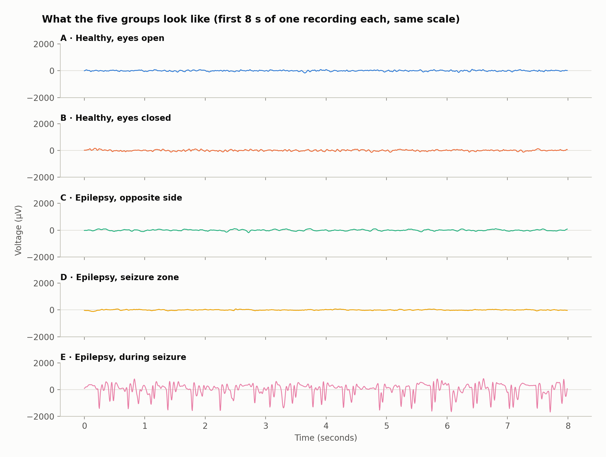 | 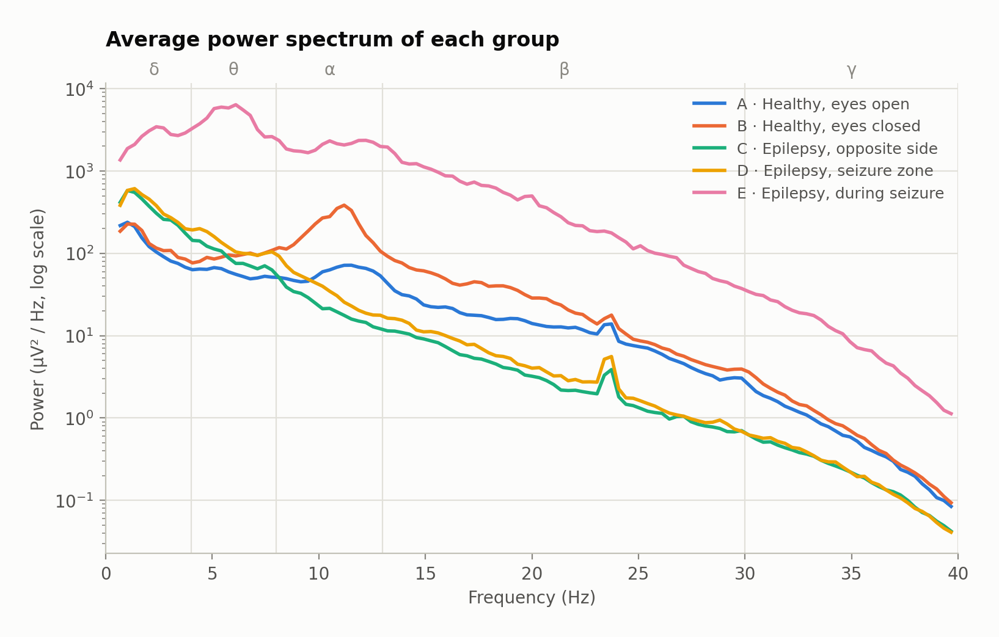 |
| 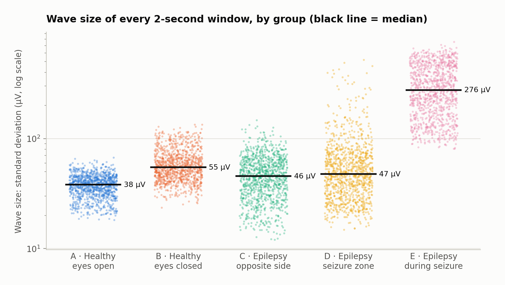 | 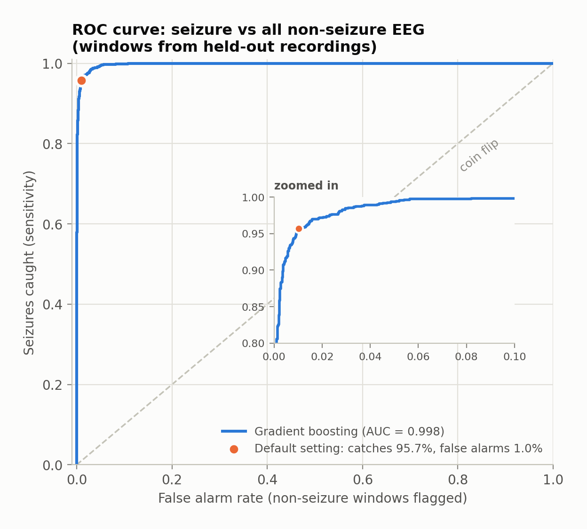 |
| 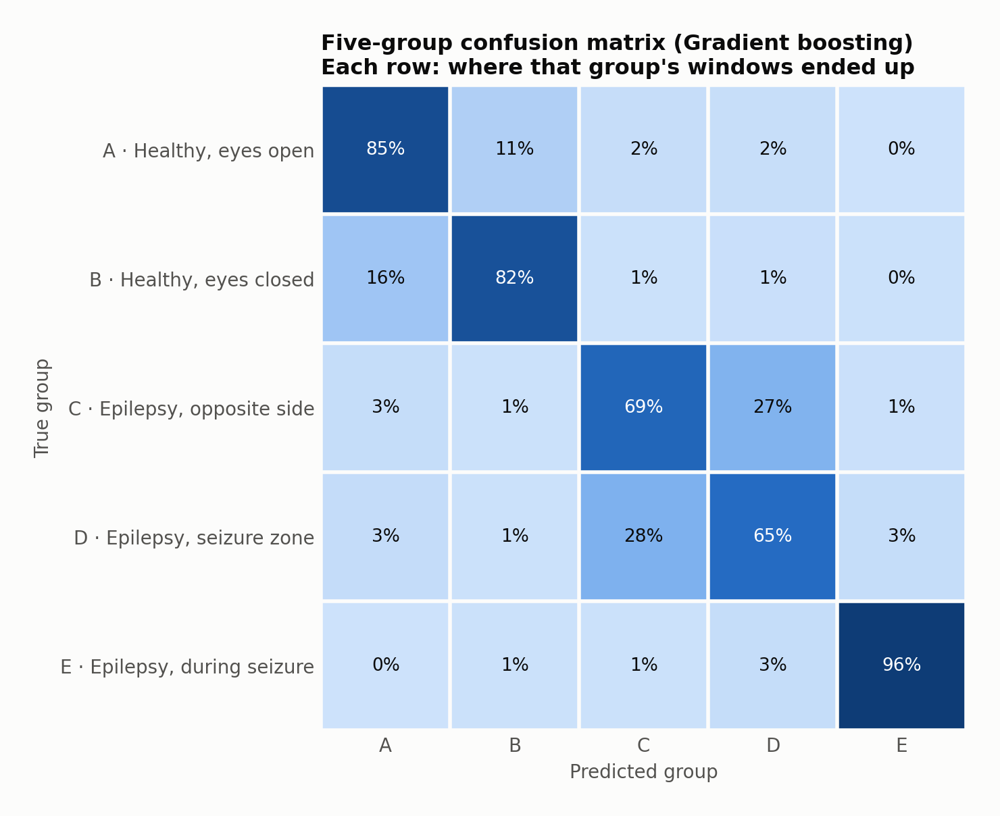 | 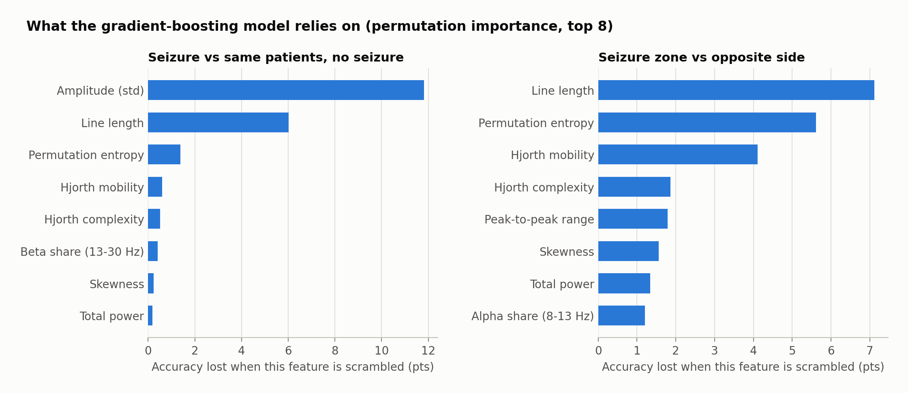 |
| 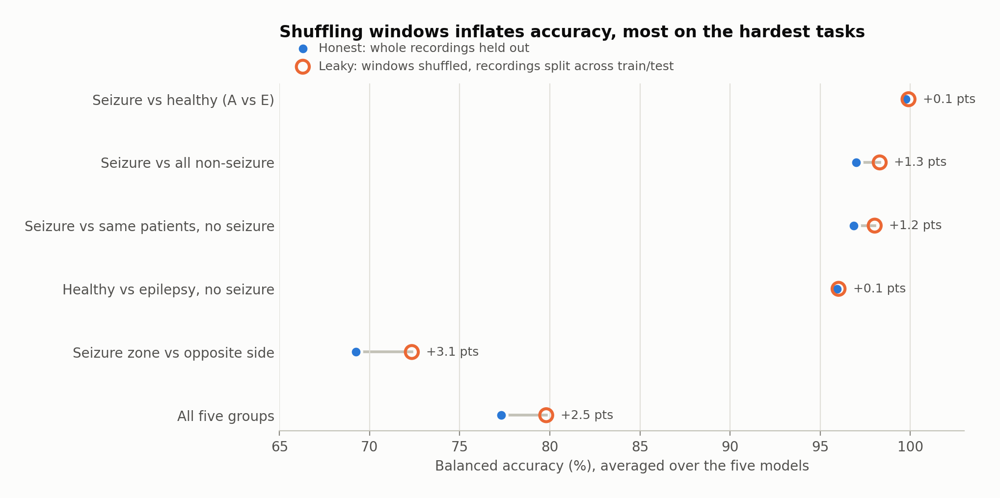 | 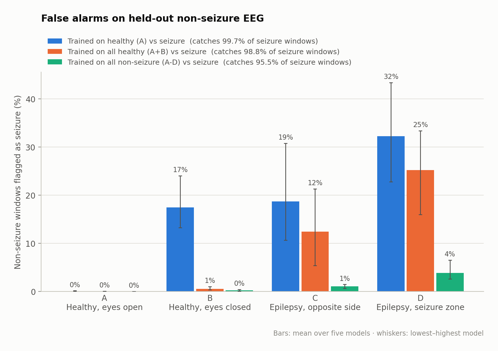 |
| 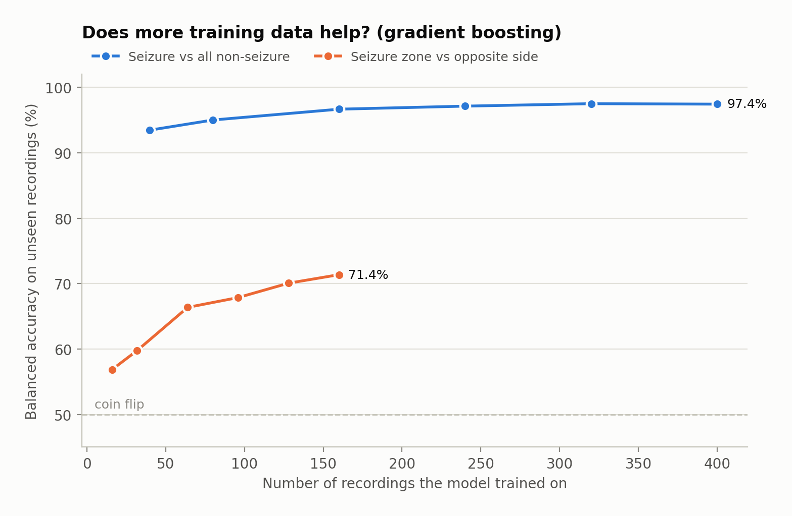 | 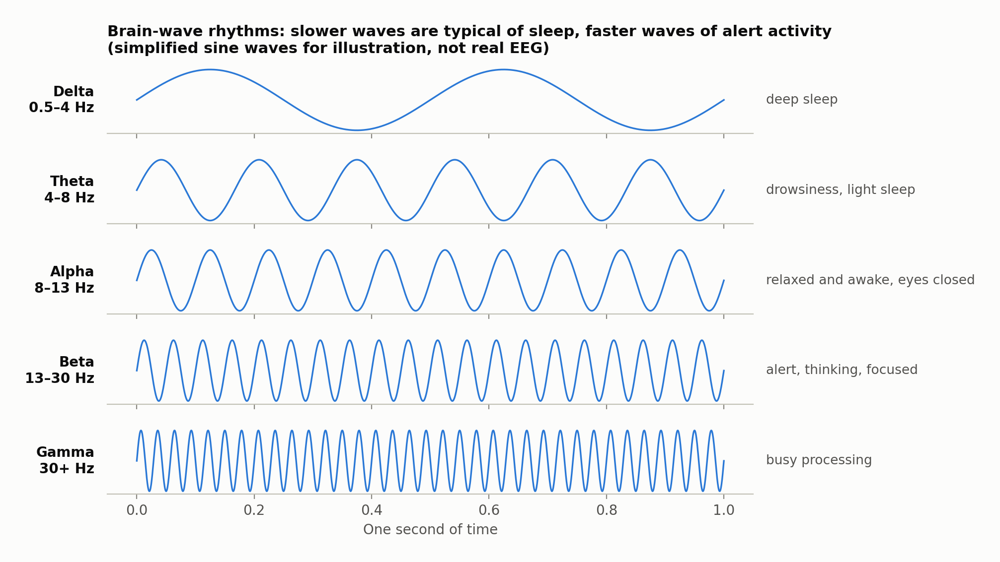 |

</details>

## The data

The [Bonn EEG dataset](https://www.upf.edu/web/ntsa/downloads) (Andrzejak et al., 2001) contains five sets of 100 single-channel segments, each 23.6 s long, sampled at 173.61 Hz.

| Set | Subjects and recording site | Electrodes | State |
|---|---|---|---|
| A | Healthy volunteers, eyes open | Scalp | Normal |
| B | Healthy volunteers, eyes closed | Scalp | Normal |
| C | Patients; hippocampal formation opposite the epileptogenic zone | Intracranial | Interictal |
| D | Patients; within the epileptogenic zone | Intracranial | Interictal |
| E | Patients; seizure activity | Intracranial | Ictal |

The data are not included in this repository. `scripts/download_data.py` downloads them from the official page; they are free for research and education.

## Run it

### Option 1: Google Colab (no installation)

Click the **Open in Colab** badge at the top of this page (or open [`notebooks/EEG_Seizure_Detection_Colab.ipynb`](notebooks/EEG_Seizure_Detection_Colab.ipynb) in Google Colab) and run the cells from top to bottom. It downloads the data, walks through training one model step by step, runs every experiment, and shows the figures.

### Option 2: On your computer (Python 3.9+)

```bash
git clone https://github.com/sanjambahl/eeg-seizure-detection.git
cd eeg-seizure-detection
pip install -r requirements.txt
python scripts/download_data.py     # downloads the Bonn dataset into data/bonn/
python run_experiments.py           # main experiments, about 10 minutes
python extra_analyses.py            # ROC, learning curve, model details, about 1 minute
python make_figures.py              # redraws figures 01–07
```

## Use it on your own EEG data

Put one single-channel recording per file in one folder per class, then run the example script with your sampling rate:

```
my_data/
    seizure/    rec01.txt   rec02.txt   ...
    normal/     rec03.txt   rec04.csv   ...
```

```bash
python examples/use_your_own_data.py my_data 256
```

It filters, windows and extracts the same 18 features, then trains and evaluates all five classifiers with recording-grouped cross-validation. Appendix A of the paper explains each step.

## Repository structure

```
eeg/
  data.py              loading, filtering, 2-second windowing
  features.py          the 18 features (4 amplitude, 14 shape)
  experiments.py       tasks, classifiers, cross-validation
  custom.py            loader for your own recordings
run_experiments.py     main experiments → results/
extra_analyses.py      ROC, learning curve, model details, held-out predictions
make_figures.py        figures 01–07
examples/              use_your_own_data.py
notebooks/             Google Colab notebook
scripts/               download_data.py
results/               all result tables (CSV/JSON)
figures/               all figures
```

## Limitations

- Small dataset: 500 short segments from ten individuals.
- Evaluation is on unseen **recordings**, not unseen individuals; the dataset does not link recordings to people.
- Healthy (scalp) and patient (intracranial) recordings differ in acquisition.
- Curated, single-channel segments are much cleaner than continuous clinical EEG.
- No hyperparameter tuning; results compare methods under equal conditions.
- The models do not forecast seizures and do not distinguish a single seizure from epilepsy.

## Citation and acknowledgments

If you use the data, please cite:

> Andrzejak RG, Lehnertz K, Rieke C, Mormann F, David P, Elger CE (2001). Indications of nonlinear deterministic and finite dimensional structures in time series of brain electrical activity: Dependence on recording region and brain state. *Physical Review E*, 64, 061907.

Built with NumPy, SciPy, scikit-learn, pandas and matplotlib.

**Use of AI tools:** An AI assistant (Claude, by Anthropic) was used to help develop the code and draft the documentation.
